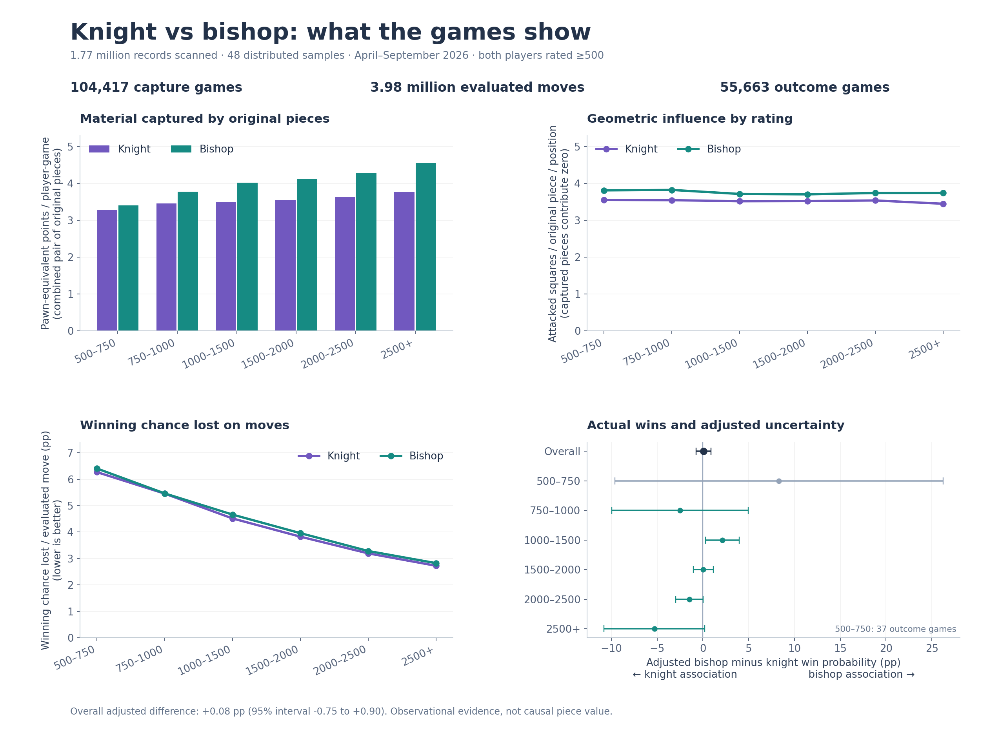
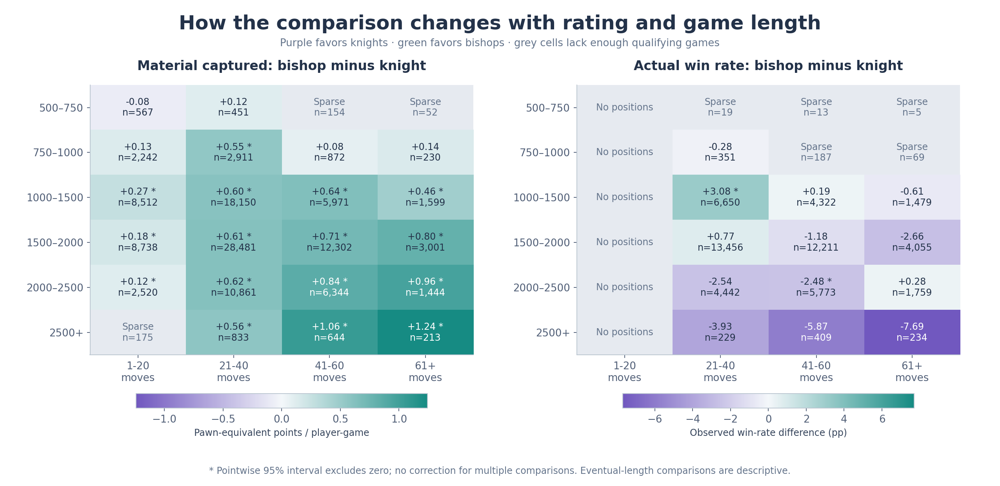

# Knight vs Bishop

A reproducible study of **material captured, spatial influence, engine winning-chance changes, and actual wins**, using the [Lichess open database](https://database.lichess.org/).

**The published sample does not establish an overall winner on actual outcomes.** Bishops captured more material and attacked more squares; knight moves lost slightly less engine-estimated winning chance on average. The adjusted bishop-minus-knight win probability was **+0.08 percentage points**, with a pointwise 95% interval of **−0.75 to +0.90**.



## Published study

The April–September 2026 run sampled 48 distributed archive windows and scanned **1,769,562 records**. These were sampled windows, not a full six-month census. The three cohorts overlap and must not be added together:

| Cohort | Size | Purpose |
|---|---:|---|
| General stable-hash sample | 104,417 games | Captures, attacked squares, legal mobility |
| Engine-annotated cohort | 181,031 games; 3,980,877 eligible moves | Adjacent winning-chance changes and normalized events |
| Balanced bishop-vs-knight positions | 55,663 games | Actual wins, draws, and adjusted associations |

| Metric | Knights | Bishops |
|---|---:|---:|
| Captured points per player-game, combined original pair | 3.546 | 4.105 |
| Attacked squares per original piece per position | 3.526 | 3.723 |
| Winning chance lost per evaluated move, percentage points | 4.020 | 4.137 |

Rating bands are **500–750, 750–1000, 1000–1500, 1500–2000, 2000–2500, 2500+**, with lower-inclusive and upper-exclusive bounds. Exclude the entire game if either player is below 500. Separate time-control pools and completed lengths of **1–20, 21–40, 41–60, and 61+ moves**. The 500–750 actual-outcome cohort contains only 37 games and is too small for a reliable conclusion.



Open [the graph gallery](results/index.html) or [the filtered report](results/report.html) locally. HTML is self-contained and works offline. GitHub displays HTML as source; use the included optional Pages workflow to serve it. [The Markdown results](results/report.md), [methods](docs/METHODS.md), and [data guide](docs/DATA.md) are readable directly on GitHub.

## Install and run

Use Python **3.12+**. From the repository root:

```bash
python -m venv .venv
# macOS/Linux:
source .venv/bin/activate
# Windows PowerShell instead:
# .\.venv\Scripts\Activate.ps1
python -m pip install --upgrade pip
python -m pip install -e .
```

The committed summaries are enough to inspect the results and regenerate every figure **without downloading chess games**:

```bash
kb-study summary
kb-study render
python -m http.server 8000 --directory results
```

Open `http://localhost:8000` for the gallery. You can also open `results/index.html` directly. `python -m knight_bishop_study` is equivalent to `kb-study`.

To reproduce from the source archives, use a **new result directory** so the published results stay intact:

```bash
kb-study sample --months 2026-04 2026-05 2026-06 2026-07 2026-08 2026-09 --strata 8 --window-mib 16 --sample-rate 0.06 --seed 20261009 --workers 3 --out work/reproduction/results --work work/reproduction/windows
kb-study outcomes --plan work/reproduction/windows/plan.json --out work/reproduction/results --work work/reproduction/outcomes --workers 3
kb-study analyze --results work/reproduction/results
kb-study validate --results work/reproduction/results
kb-study render --results work/reproduction/results
```

Use `kb-study sample --help` and `kb-study outcomes --help` for sampling and worker options. HTTP ranges and complete independent Zstandard frames avoid full archive downloads. Raw payloads stay in RAM and are released after processing. Reduced databases remain locally for audit; they are ignored by Git. The original run transferred approximately 1.61 GB in two passes across source archives totaling 175.7 GB. Full reproduction can take substantial CPU time and several GB of RAM depending on workers and window sizes.

If you already have the reduced-data archive, follow [the data guide](docs/DATA.md) to analyze it without refetching games. `requirements-reproduction.txt` records the original direct dependency versions; ordinary installation uses the supported dependency ranges in `pyproject.toml`.

## Method and limits

Track the original minor pieces; promotions do not become original knights or bishops. Normalize events by **all eligible move opportunities in the same bucket**, retaining event counts and denominators. Engine comparisons require immediately adjacent annotations, use the mover's perspective, and apply the [Lichess winning-chance mapping](https://lichess.org/page/accuracy).

Actual-outcome comparisons select predeclared checkpoints with one original minor per side, bishop versus knight, equal pawn/rook/queen counts, owners in the same rating band, and a rating gap of at most 100. A regularized logistic model adjusts for recorded position and player features. Validation holds out complete source windows. Capture and move intervals use 1,000 window bootstrap replicates; outcome-model intervals use window-clustered covariance.

These are **observational associations**, not causal credit for every piece. Byte-window inclusion, selection into engine analysis, earlier trades, unmeasured position details, repeated players, sparse cells, and multiple comparisons limit conclusions. Final game length is descriptive, not a model predictor. See [METHODS.md](docs/METHODS.md) for precise definitions and model controls.

## Development

```bash
python -m pip install -e ".[dev]"
python -m unittest discover -s tests -v    
ruff check src tests
kb-study render
node scripts/check_report.js
python -m build
```

Node.js is needed only for the report-filter check. GitHub Actions runs tests, lint, package builds, and offline rendering on Linux and Windows. It does not download the chess archives. [CONTRIBUTING.md](CONTRIBUTING.md) describes changes to the scientific method; [publishing instructions](docs/PUBLISHING.md) cover GitHub, optional Pages, and large release assets.

## License and acknowledgements

Project code is **GPL-3.0-or-later**; see [LICENSE](LICENSE). The source database is published under CC0 by [Lichess](https://database.lichess.org/). Dependencies retain their own licenses; [NOTICE.md](NOTICE.md) identifies the key sources.

The preprocessing and normalization workflow was inspired by [Antiochian/chess-blunders](https://github.com/Antiochian/chess-blunders/blob/main/README.md). This repository implements its own board replay, piece attribution, outcome analysis, and plotting. It is not affiliated with Lichess or the reference study.
